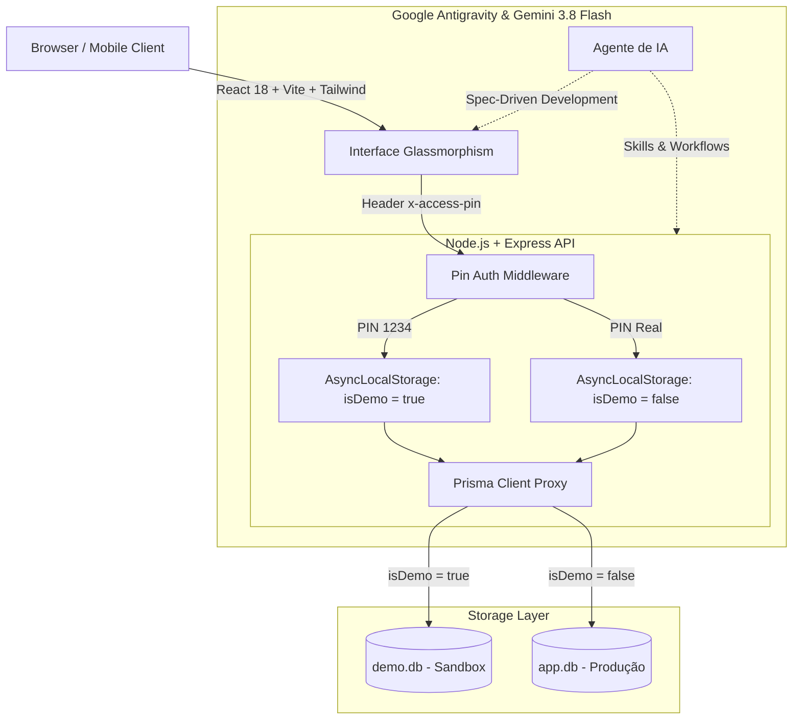

# 🚛 TransFrete Pro — Gestão Inteligente de Fretes & Frotas

<div align="center">


<br>


<br><br>

**TransFrete Pro** é uma plataforma completa e intuitiva desenvolvida para a gestão operacional, logística e financeira de transportes rodoviários de carga. Criada para atender a rotina real das estradas, integrando controle de fretes, viagens de ida e volta, gestão de combustível por tanque duplo, manutenção preventiva de motor e carreta, e fechamento financeiro mensal com apuração do restante a pagar.

[🎮 Teste no Modo Demo](#-modo-demonstração--portfólio-teste-público) • [Recursos](#-recursos-principais) • [Destaque de IA](#-desenvolvimento-com-ia-antigravity--gemini-38-flash) • [Arquitetura](#-arquitetura--stack-tecnológica) • [Instalação](#-como-executar-o-projeto) • [Deploy](#-deploy--produção)

</div>

---

## 🎮 Modo Demonstração / Portfólio (Teste Público)

Para permitir que recrutadores, desenvolvedores e visitantes experimentem a plataforma livremente sem comprometer dados operacionais reais, o sistema conta com uma arquitetura de **Sandbox / Modo Demonstração**:

```
🔐 PIN DE DEMONSTRAÇÃO: 1234
👉 Clique em "Testar Agora (1234)" na tela inicial ou digite 1234 no teclado numérico
```

### 🛡️ Isolamento Arquitetural de Dados (Zero Risco)
- **Chaveamento Dinâmico em Tempo de Execução**: O backend utiliza `AsyncLocalStorage` e um `Proxy` do Prisma ORM para rotear requisições transparentemente.
- **Banco de Dados Sandbox (`demo.db`)**: Ao autenticar com o PIN `1234`, todas as operações (criação de fretes, abastecimentos, checklists, exclusões e edições) ocorrem exclusivamente em um banco SQLite isolado, pré-populado com dados realistas do mês corrente.
- **Proteção Total do Banco de Produção (`app.db`)**: Dados operacionais reais permanecem criptografados e inacessíveis a testes públicos.

---

## ⚡ Desenvolvimento com IA: Antigravity & Gemini 3.8 Flash

> [!NOTE]  
> Este projeto foi concebido, arquitetado e implementado em conjunto com o **Agente de IA Antigravity** impulsionado pelo modelo **Gemini 3.8 Flash**, unindo velocidade ultra-rápida de raciocínio, geração de código contextualizada e rigor técnico em todo o ciclo de engenharia de software.

### Como a IA acelerou o desenvolvimento:
- **Engenharia de Software Orientada a Agentes (Agent-Driven Development)**: Uso do ecossistema `.agent/` com catálogo modular de *Skills* especializadas (gestão de fretes, despesas financeiras, manutenção de caminhão e dashboard analítico), *Workflows* automatizados e regras de arquitetura bem delimitadas.
- **Full-Stack Reativo & Concorrente**: Desenvolvimento simultâneo da interface do usuário (React 18, TypeScript, Tailwind CSS) e da API REST com Prisma ORM e controle transacional.
- **Design System com Glassmorphism**: Interface moderna em tons escuros (*Dark Mode*), navegação fluida com barra touch inferior nativa para celulares (`MobileBottomNav`) e *Sidebar* colapsável no desktop.
- **Régua Lógica e Financeira Real**: Codificação das regras operacionais do setor: cálculo de saldo a receber programado na segunda-feira seguinte à entrega, remuneração fixa por viagem do motorista (R$ 700), rateio de despesas fixas (seguro, rastreador Sascar) e projeção de metas mensais.

---

## 🎯 Recursos Principais

### 📦 1. Gestão Completa de Fretes & Viagens
- **Fluxo do Frete**: Planejamento, carregamento, trânsito e entrega finalizada.
- **Regras Comerciais**: Frete bruto, adiantamento com transportadora, taxa de agenciamento, diária do motorista e data de recebimento do saldo.
- **Flexibilidade de Trajeto**: Suporte a viagens só de ida, ida e volta, múltiplos waypoints intermediários e controle de peso/tonelagem.

### ⛽ 2. Gestão de Combustível (Diesel S10 & Arla 32)
- Suporte a conjunto com **Tanque Duplo (600L principal + 300L auxiliar)**.
- Registro com litros, valor total, preço por litro, odômetro atual e posto de abastecimento.
- Cálculo automatizado de **média de consumo (km/l)** e custo por quilômetro rodado.

### 🛠️ 3. Manutenção & Saúde do Caminhão
- **Alerta de Troca de Óleo**: Monitoramento contínuo baseado no intervalo técnico de 20.000 km para motores pesados.
- **Conjunto Monitorado**: Especificações completas do cavalo mecânico (Iveco Stralis) e semirreboque (Carreta Randon).
- **Checklist Diário Pré-Viagem**: Inspeção visual dos 6 itens mandatórios de segurança (pneus, sistema de freios, suspensão, conjunto de luzes, documentação e lacre).

### 💳 4. Finanças & Restante a Pagar
- **Apuração de Saldo Mensal**: Resumo detalhado de todas as contas a pagar no mês (diesel, diárias, custos fixos e manutenções).
- **Gestão de Financiamento**: Controle de contratos, parcelas pagas/pendentes, amortização da dívida e projeção de quitação da frota.
- **Despesas Recorrentes & Extras**: Separação clara entre custos fixos mensais (seguro da carga/veículo, rastreador Sascar) e despesas de viagem (pedágios, alimentação, borracharia).

### 📊 5. Dashboard Analítico Executivo
- **Indicadores Chave (KPIs)**: Receita bruta, faturamento líquido, total de custos e lucro operacional real.
- **Termômetro de Metas**: Acompanhamento dinâmico da meta de faturamento mensal (R$ 35.000) e meta de lucro líquido (R$ 12.000).
- **Simulador de Fretes**: Ferramenta pré-viagem para testar a viabilidade econômica antes de fechar o frete (estimativa de lucro líquido, diesel necessário e margem percentual).

### 🔒 6. Autenticação Rápida & Segurança
- Tela de bloqueio por PIN com teclado virtual integrado e suporte a teclado físico.
- Alternância imediata entre o ambiente de demonstração e o ambiente seguro.

---

## 🏗️ Arquitetura & Stack Tecnológica



| Camada | Tecnologias Utilizadas |
| :--- | :--- |
| **Frontend** | React 18, TypeScript, Vite, Tailwind CSS, Lucide React, Canvas Confetti |
| **Backend** | Node.js, Express, TypeScript (`tsx`), CORS, Dotenv, AsyncLocalStorage |
| **Persistência** | Prisma ORM, SQLite (com chaveamento dinâmico multi-tenant por contexto) |
| **Inteligência Artificial** | **Google Antigravity** + **Gemini 3.8 Flash** |
| **DevOps & Containers** | Docker, Docker Compose, GitHub Actions (CI/CD contínuo para VPS) |

---

## 🚀 Como Executar o Projeto

### Pré-requisitos
- [Node.js](https://nodejs.org/) (v18 ou superior)
- [npm](https://www.npmjs.com/) ou [yarn](https://yarnpkg.com/)
- [Docker](https://www.docker.com/) *(opcional para execução conteinerizada)*

### 1. Clonar o Repositório
```bash
git clone https://github.com/SEU_USUARIO/transfrete-pro.git
cd transfrete-pro
```

### 2. Instalar as Dependências
```bash
npm install
```

### 3. Configurar as Variáveis de Ambiente
Crie um arquivo `.env` na raiz do projeto (use o `.env.example` como referência):
```env
PORT=8080
DATABASE_URL="file:../data/app.db"
SECRET_KEY=transfrete_jwt_secret_dev
DEFAULT_ADMIN_PIN=2703
```

### 4. Inicializar o Banco de Dados
```bash
npm run db:push
```

### 5. Iniciar a Aplicação em Modo Desenvolvimento
O comando abaixo inicia concorrentemente a API Express e o servidor Vite do frontend:
```bash
npm run dev
```

- **Frontend**: `http://localhost:5173`
- **Backend API**: `http://localhost:8080`

> Para testar de imediato sem cadastrar nada, digite o PIN **`1234`** na tela inicial!

---

## 🐳 Executando com Docker

Se desejar executar toda a stack conteinerizada com Docker Compose:

```bash
docker compose up -d --build
```

A aplicação ficará disponível na porta configurada (padrão: `http://localhost:80` ou `http://localhost:8080`). O volume `data/` é persistido de forma segura fora do contêiner.

---

## 🚢 Deploy Contínuo (CI/CD)

O projeto está configurado para deploy automático em VPS com Docker via **GitHub Actions** (`.github/workflows/deploy.yml`):
- A cada `git push` na branch `main`, a esteira compila a aplicação e executa a sincronização segura via SSH.
- Instruções completas para configuração de Secrets e VPS estão disponíveis no [Guia de Deploy](DEPLOY_GUIA.md).

---

## 🧠 Arquitetura de Agente (`.agent/`)

Este repositório possui uma estrutura de desenvolvimento assistido por agentes:
- `.agent/agent_config.json`: Metadados do agente, hiperparâmetros e contexto do projeto.
- `.agent/skills/`: Habilidades especializadas em gestão de fretes, financeiro, manutenção preventiva e visual analytics.
- `.agent/workflows/`: Fluxos de trabalho documentados para rotinas recorrentes.
- `.agent/rules/`: Diretrizes de padronização arquitetural e integridade de código.

---

## 👨‍💻 Autor

Desenvolvido por **Thiago** como projeto pessoal para modernizar a gestão de transporte e fretes rodoviários.

Construído com código limpo, foco na usabilidade e o poder do **Agente de IA Antigravity** impulsionado pelo **Gemini 3.8 Flash**.

---

## 📄 Licença

Este projeto está sob a licença [MIT](LICENSE).
